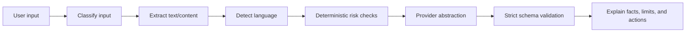

# AI Pipeline

The planned pipeline is: receive input, classify type, extract content, detect language, identify intent, run deterministic risk checks, retrieve sources when needed, validate structured model output, and generate confirmed next steps.

No AI provider or credentials are configured in Phase 1.
