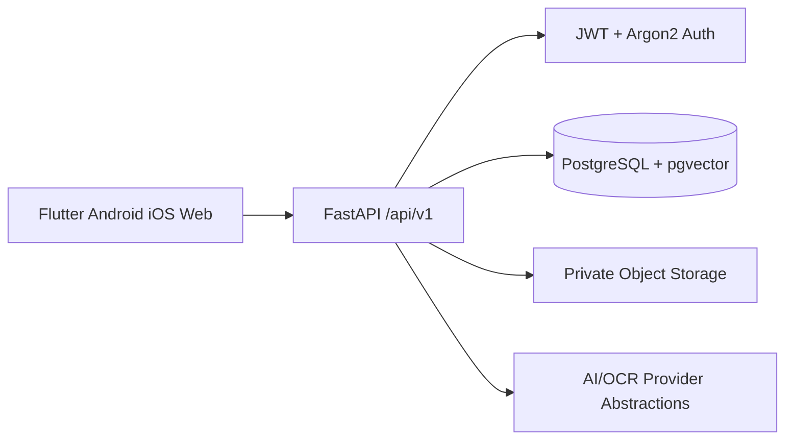

# Architecture

ORVEXA uses a modular monolith with a Flutter client and a Python FastAPI service. PostgreSQL is the source of truth; the current local storage provider is private filesystem storage behind a service boundary and can be replaced by object storage.

## Boundaries

- UI state and navigation remain in Flutter.
- API validation, authorization, orchestration, and audit decisions remain server-side.
- Database access is isolated behind repositories/services and async SQLAlchemy sessions.
- AI output will be validated against strict schemas and never treated as proof.

## Current implementation

`backend/app/main.py` configures CORS, security headers, exception handling, and versioned routers. Authenticated document, context, action, search, extraction, and analysis modules are routed through ownership checks. `frontend/lib/main.dart` provides the Flutter shell; API URLs are compile-time configuration and mobile tokens use secure storage. Workers process queued document jobs separately from request handling.
