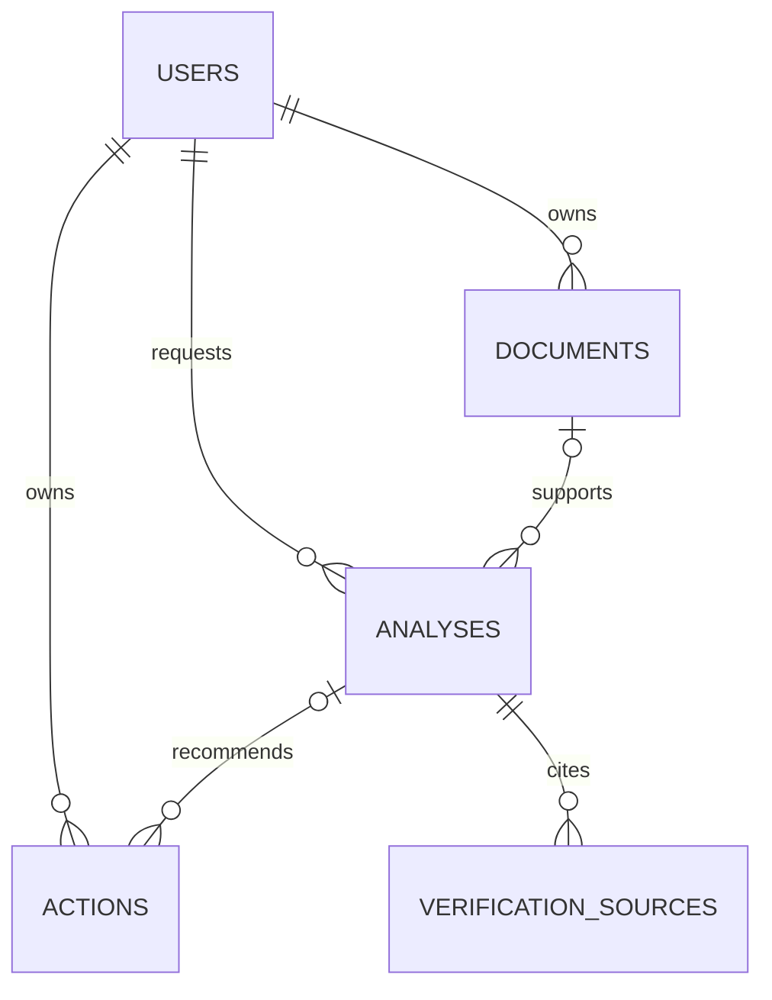

# Database Design

PostgreSQL with UUID keys, UTC timestamps, foreign keys, explicit ownership checks, indexes, and Alembic migrations is planned for Phase 2. No schema or migration is claimed in Phase 1.

Ownership must be enforced server-side for every user-scoped query. Account deletion and retention policies must be implemented transactionally before production use.
